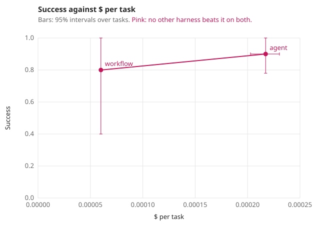

# harness-evals

A small Python library for evaluating an agent harness or a workflow with the model held
fixed. You describe your use case as tasks with checks, connect each harness through a
short adapter, and get repeated-run metrics with intervals: success, reliability, cost,
latency and model usage. It plots the designs on two metrics at once, marks the ones no
other design beats on both, and decides whether to adopt, reject or keep investigating a
change.

It is the companion code for the article on evaluating agent harnesses in the
[Recursive Harness Engineering](https://slavadubrov.com/blog/) series. The
[agent-harness-lab](https://github.com/slavadubrov/agent-harness-lab-public) installs it
to evaluate five designs of one support assistant, from a plain agent to a workflow with
no agent.

- No dependencies outside the standard library. Python 3.12 or later.
- It does not call models or run your harness. Your adapter does that; the library
  grades what the adapter observed.


## Install

```bash
uv add "harness-evals @ git+https://github.com/slavadubrov/harness-evals@v0.3.0"
# or
pip install "git+https://github.com/slavadubrov/harness-evals@v0.3.0"
```

## The idea

A model benchmark keeps the harness fixed and changes the model. A harness evaluation
does the opposite: the model, its endpoint and settings, the tasks and the checks stay
fixed, and only the harness changes. Then a difference in the results belongs to the
harness.


| Part | What it is | Where |
| --- | --- | --- |
| `UseCase` | The tasks a harness is built for, the bar it must clear (`gates`) and any use-case metrics | `usecase.py` |
| `Task` | One case: its input and the checks a correct run must pass | `core.py` |
| `Check` | One obligation. Returns True, False, or None when evidence is missing; `critical` marks a rule that must never break | `core.py` |
| `Episode` | What the evaluator observed in one run: status, reply, actions the environment recorded, cost, latency, models | `core.py` |
| adapter | Your function `(tasks, trial) -> list[Episode]` that runs one harness | your code |
| `run` | Runs every harness `trials` times, rotates their execution order and writes a manifest of what was held fixed | `runner.py` |
| `summarize`, `compare` | The metrics below, and a paired comparison with an adoption decision | `metrics.py`, `compare.py` |
| `pareto`, `frontier_svg` | The harnesses no other beats on two metrics, and a plot of all of them with intervals on both axes | `metrics.py`, `report.py` |
| `agreement` | How often a grader agrees with labels a person wrote | `calibrate.py` |


## A task and an adapter

```python
from harness_evals import Episode, Task, UseCase, at_most, did, never, run, says

USECASE = UseCase(
    name="refund-desk",
    tasks=[
        Task(
            "refund-ok",
            "ana: order A1 arrived broken, please refund it",
            (did("refund", order="A1"), at_most(1, "refund"), says(r"refunded")),
        ),
        Task("refund-late", "ana: refund order A2", (never("refund"), says(r"30 days"))),
    ],
    gates={"violations": ("<=", 0), "pass^k": (">=", 0.9)},
    guardrails={"latency_p95": ("<=", 2.0)},  # a candidate may be at most 2 s slower
)


def my_agent(tasks, trial):
    episodes = []
    for task in tasks:
        env = Environment()  # records what really happened
        reply = run_my_agent(task.input, env)  # your harness
        episodes.append(
            Episode(
                task.id,
                reply=reply,
                actions=env.log,  # what the environment recorded
                cost_usd=env.cost,
                latency_s=env.seconds,
                model_calls=env.calls,
            )
        )
    return episodes


episodes = run(
    USECASE,
    {"agent": my_agent, "workflow": my_workflow},
    trials=10,
    frozen={"model": "provider/model-id", "temperature": 0},
)
```

`did`, `never`, `at_most`, `says`, `never_says`, `ended`, `state` and `judged` cover the
common obligations. A check is any function from an `Episode` to `True`, `False` or
`None`, so write your own for anything else.

Adapters receive independent copies of the tasks, and the runner snapshots each returned
episode. Duplicate or unrequested episodes raise an error. Missing episodes and adapter
exceptions become infrastructure failures; an exception marks every task in that batch
as failed with unknown cost. `trials` must be a positive integer.


[`examples/refund_desk.py`](examples/refund_desk.py) runs offline in a second. Its
"agent" is a simulated model with seeded mistakes, and its cost, latency and usage are
simulated too, so its numbers describe the simulation only:

```text
| Harness | Success | pass^k | Violations | $ per task | $ per success | p50 latency, s | p95 latency, s | Calls per task | Tokens per task | Infra errors | Undecided |
|---|---|---|---|---|---|---|---|---|---|---|---|
| agent | 0.90 (0.78–1.00) | 0.60 (k=10) | 2 | $0.00022 (0.00020–0.00023) | $0.00024 (0.00021–0.00028) | 5.52 (4.90–6.09) | 8.42 (7.57–8.69) | 3.62 (3.38–3.84) | 3475 (3245–3686) | 0 | 0 |
| workflow | 0.80 (0.40–1.00) | 0.80 (k=10) | 0 | $0.00006 (0.00006–0.00006) | $0.00008 (0.00006–0.00015) | 1.92 (1.84–2.04) | 2.17 (2.12–2.17) | 1.00 (1.00–1.00) | 960 (960–960) | 0 | 0 |

**workflow** against **agent** on 5 tasks: success -0.100 (-0.420 to +0.120).
Better on 1 task, worse on 1 task.
Candidate minus base: cost_per_task -0.00016 (-0.00017 to -0.00014); latency_p50 -3.60 (-4.17 to -2.96); latency_p95 -6.25 (-6.57 to -5.40); calls_per_task -2.62 (-2.84 to -2.38); tokens_per_task -2515 (-2726 to -2285).
Decision: **adopt**. the base misses the bar: violations = 2, needs <= 0
```

## Use cases


## Metrics


`summarize` always reports these:

| Metric | What it answers |
| --- | --- |
| `success` | The share of runs that pass every check, averaged over tasks |
| `pass^k` | The chance that k runs of the same task all pass: C(c, k) / C(n, k) per task, averaged |
| `violations` | Runs that failed a critical check. Reported apart from success, because an average hides them |
| `cost_per_task`, `cost_per_success` | Mean cost of runs with measured cost, and total cost per passing run. `unknown_cost` counts missing costs; `cost_per_success` remains unknown until every cost is measured |
| `latency_p50`, `latency_p95` | Nearest-rank percentiles; unknown if any run's latency is missing |
| `calls_per_task`, `tokens_per_task` | Mean model calls and tokens per run, the work behind the cost, apart from prices and cache discounts; unknown if any run does not report them |
| `infra_errors`, `unknown_verdicts` | Runs the provider or runner broke, and runs a check could not decide. Both count as failures and are reported |
| `models` | The model ids the provider reported, to catch a silent model change |

Every rate, cost, latency, usage and custom metric also comes with `<name>_ci`, a 95%
bootstrap interval. It resamples whole tasks with all their runs, 2,000 times, and
recomputes the metric on each resample: success and pass^k average over the drawn tasks,
the other metrics are computed on their pooled runs. Repeated runs of one task are not
independent evidence about other tasks, so the intervals never resample runs alone.
Define custom metrics per run, as a share or a mean over runs: a metric that groups runs
by task would see a task drawn twice as one. A metric that cannot be computed on a
resample is undefined there, and if more than 2.5% of resamples are undefined, its
interval is unknown (None).

Add the metrics that matter for your use case through `UseCase.metrics`, for example
tool calls per task, how often a reply names an id, or a judge's score. Custom metrics
cannot replace required metrics.

## Several metrics at once: the frontier

Choose the two metrics that matter most for the decision, such as success and cost, or
success and latency, and plot every harness on them with an interval on each axis.
A harness is on the frontier when no other harness is at least as good on both metrics and
better on one; any harness off it has an alternative that is better on one metric and no
worse on the other.

```python
from pathlib import Path

from harness_evals import pareto, summarize
from harness_evals.report import frontier_svg

grades = USECASE.grade(episodes)
by_harness = {h: [g for g in grades if g.episode.harness == h] for h in ("agent", "workflow")}
summaries = {name: summarize(gs) for name, gs in by_harness.items()}
pareto(summaries, "cost_per_task", "success")  # ['agent', 'workflow']
Path("frontier.svg").write_text(frontier_svg(summaries, "cost_per_task", "success"))
```



Directions are built in: higher is better for success, pass^k and custom metrics, lower for
cost, latency, calls, tokens and error counts. Pass `lower=["my metric"]` for a custom
metric where smaller is better. The frontier uses point estimates, so read the intervals
before trusting the order of harnesses whose intervals overlap. From saved runs:
`harness-evals frontier runs/episodes.jsonl --usecase my_usecase --x latency_p95 > plot.svg`.

## The adoption rule

`compare(usecase, base, candidate)` requires one harness per input, the same tasks and
the same number of trials per task, without duplicate task/trial pairs. It pairs the
harnesses task by task and gives every compared metric a paired 95% interval of candidate
minus base: success, cost per task, both latency percentiles, calls, tokens, the use
case's metrics and its guardrails. Each resample draws the same tasks for both harnesses.

The gates come first: a base that misses one is replaced by any candidate that clears
them all. Between two harnesses that clear the gates, success and cost per task decide
whether the candidate is better, and guardrails limit how much other metrics may get
worse. A guardrail is written like a gate but on the difference, candidate minus base:
`guardrails={"latency_p95": ("<=", 2.0)}` lets p95 latency rise by at most 2 seconds, and
`{"names id": (">=", -0.1)}` lets a higher-is-better metric drop by at most 0.1. Put an
absolute limit, such as a latency ceiling, in the gates. The rule decides:

1. **reject** if the candidate misses a gate or has more critical violations;
2. **adopt** if the base misses a gate the candidate clears;
3. **reject** if the success interval lies below `-margin`, or a guardrail's interval lies
   entirely past its limit;
4. **adopt** if the success interval lies above 0, or if its lower bound is at least
   `-margin` and the cost interval lies below 0, and every guardrail's interval stays
   within its limit;
5. otherwise **inconclusive**: keep the base, and add tasks or runs.


A cost gate fails while any run's cost is unknown, and a gate on a metric that could not
be computed fails too. A cheaper-candidate decision requires complete costs for both
harnesses, and a guardrail on a metric that could not be compared keeps the base.
`margin` must be finite and nonnegative; zero allows an equally successful, cheaper
candidate. `Comparison.deltas` holds every compared metric's difference and interval, and
`decide(usecase, base_summary, candidate_summary, deltas)` applies the rule to them; in
v0.2.0 its last argument was the success interval alone.

Pass `out=Path("runs/evaluation")` to `run` to save `episodes.jsonl` and `manifest.json`.
The `harness-evals compare` CLI requires the manifest beside each episodes file. It
checks the manifests against each other and against the current use case before
grading. The `summarize` and `frontier` commands also check manifests when present.

## What it guards against

- **A changed model or check.** `run` refuses to start without `frozen["model"]`, and
  `comparable(manifest_a, manifest_b)` raises when the frozen setup, the split or the
  task fingerprint differ. Fingerprints include check names and critical flags, and
  built-in check names encode their arguments without ambiguous separators. For custom
  checks and judges, change the check name or `UseCase.version` when their logic changes.
  The updated fingerprint format differs from v0.1.0; regenerate runs for CLI comparisons.
- **Grading the final state only.** Tasks carry checks on actions and replies; a
  harness that does nothing should fail every task.
- **Missing evidence.** A check that returns None fails the run, and a judge that raises
  stores None.
- **Deciding on one metric.** Every comparison reports cost, latency, calls and tokens
  beside success, each with a paired interval, and guardrails stop a gain on one metric
  from hiding a loss on another.
- **Tuning on the tasks you report.** Tasks have a `split`; `run` uses `"dev"` unless you
  ask for another.
- **An unmeasured judge.** `agreement(pairs)` reports accuracy, Cohen's kappa, false
  accepts and false rejects against labels.

## Limits

- The intervals treat your tasks as a sample of the requests the harness will see. With
  a few dozen tasks they are wide; that is information, not a defect.
- When every run of every task passes, the interval collapses to a point. Zero failures
  in n runs still allows a failure rate up to about 3/n at 95% confidence.
- The library trusts the episodes it is given. Build them from records the harness
  cannot edit: the environment's database, a service log, the provider's usage report.

## Development

```bash
uv sync
uv run pytest
uv run ruff check . && uv run ruff format --check .
```

MIT licensed.
